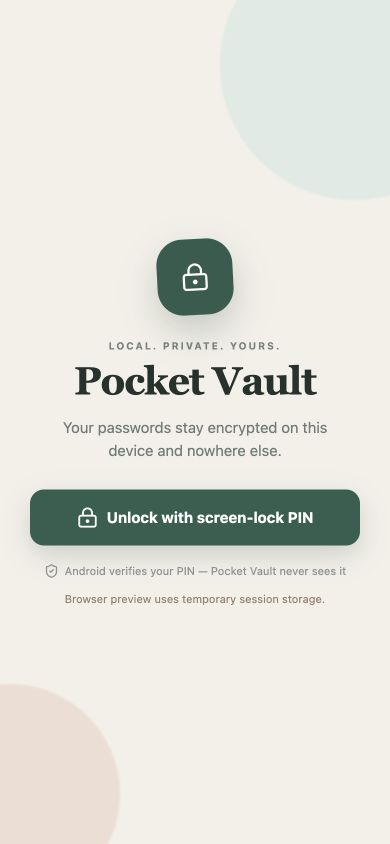
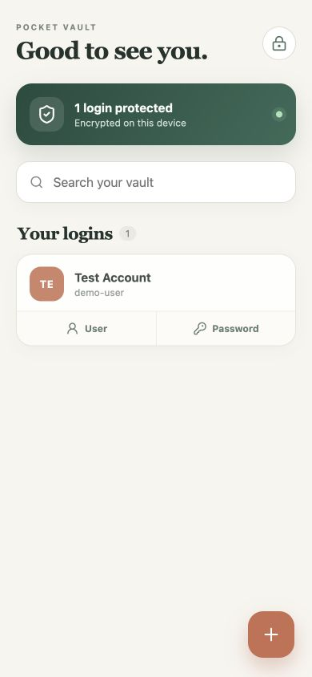
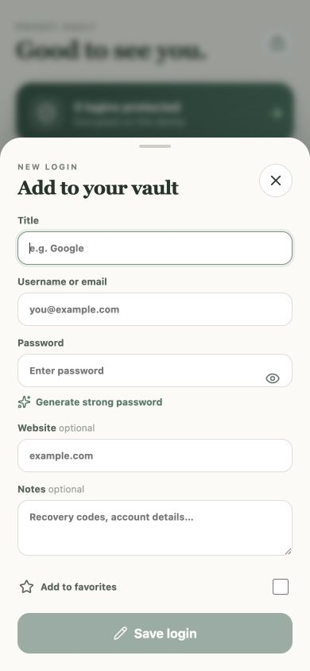

# Pocket Vault

Pocket Vault is a local-only Android password manager. It stores encrypted logins on the device, unlocks with an app-specific six-digit PIN, supports recovery and portable encrypted backups, and can participate in Android's Autofill save flow.

> [!IMPORTANT]
> This is an early-stage personal security project and has not received an independent security audit. Review the threat model before trusting it with important credentials.

  
  
  

## Features

- Local AES-256-GCM encrypted vault
- App-specific six-digit PIN
- Unique recovery code shown once during setup
- PIN recovery without deleting saved logins
- Username and password copy actions
- Android 13+ sensitive clipboard marking and timed clearing
- Encrypted .pvault backup export and clean-install restore
- Android Autofill save prompts for compatible apps and websites
- Automatic lock when backgrounded and after five minutes of inactivity
- No URL or notes fields
- No account, analytics, cloud backend, or INTERNET permission
- Browser preview for UI testing

## Security design

Pocket Vault generates a random 256-bit AES master key. The vault is encrypted with that key using AES-GCM. Independent PBKDF2-derived keys wrap the master key for the PIN and recovery code. Neither the PIN nor recovery code is stored.

The Android app disables OS backups, device transfer, screenshots, screen recording, and cleartext traffic. Accepted Autofill credentials remain only in process memory until the vault is unlocked and the user confirms the new entry.

The recovery code can reset the PIN, but it does not contain the saved logins. A portable backup contains encrypted vault data and recovery-wrapped key material; restoring it requires the matching recovery code.

See [SECURITY.md](SECURITY.md) for the threat model and disclosure process and [PRIVACY.md](PRIVACY.md) for data-handling details.

## Quick start

Requirements:

- Node.js 22
- npm

~~~bash
npm ci
npm run dev
~~~

Open http://127.0.0.1:5173/.

The browser build is a UI preview. Its PIN and vault state can reset after refresh, and Android-only features such as the system Autofill prompt and document picker require a device or emulator.

## Build the Android debug APK

Additional requirements:

- JDK 21
- Android SDK with API 36

~~~bash
npm ci
npm run android:apk
~~~

Output:

~~~text
android/app/build/outputs/apk/debug/app-debug.apk
~~~

Never distribute the debug APK as a production release.

## Enable Android Autofill

1. Unlock Pocket Vault.
2. Open **Vault settings**.
3. Select **Enable Android Autofill**.
4. Choose Pocket Vault as the preferred Autofill service.
5. Submit a compatible sign-up or login form.
6. Accept Android's Save prompt.
7. Unlock Pocket Vault, review the captured details, and select **Save login**.

Autofill requires Android 8 or newer. Apps and websites must expose compatible username/password fields, so a save prompt cannot be guaranteed for every form. Pocket Vault does not request Accessibility access.

## Move to a new phone

1. On the old phone, unlock Pocket Vault and open **Vault settings**.
2. Select **Export encrypted backup** and save the .pvault file.
3. Transfer the file to the new phone.
4. Install Pocket Vault on the new phone.
5. Select **Restore encrypted backup** before creating a PIN.
6. Choose the file, enter the original recovery code, and create a new PIN.

Keep the backup and recovery-code file in separate secure locations. Anyone holding both can restore the vault.

## Quality checks

~~~bash
npm run lint
npm run build
npm run android:sync
cd android
./gradlew --no-daemon testDebugUnitTest assembleDebug
~~~

GitHub Actions runs equivalent checks for pushes and pull requests.

## Project layout

~~~text
src/                                  React UI and browser preview adapter
android/app/src/main/java/...         Native encryption, backup, clipboard, and Autofill
android/app/src/main/res/             Android resources and service declarations
docs/DEPLOYMENT.md                    Release signing and Play Store guide
.github/workflows/ci.yml              Continuous integration
~~~

## Documentation

- [Deployment and Play Store guide](docs/DEPLOYMENT.md)
- [Architecture](docs/ARCHITECTURE.md)
- [Privacy](PRIVACY.md)
- [Security policy](SECURITY.md)
- [Contributing](CONTRIBUTING.md)
- [Changelog](CHANGELOG.md)

## License

No open-source license has been selected. Copyright rights remain with the repository owner unless a license is added later.
